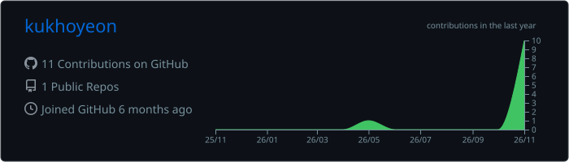

<!-- 상단 터미널 타이핑 헤더 -->

  

<!-- 방문자 수 & 연락처 배지 -->

  
  
  

 

<!-- 좌우 2단 레이아웃 -->
<table>
  <tr>
    <td valign="top" width="52%">
      <h3><code>&gt;_</code> Profile</h3>
<pre>
Name        : HoYeon Kuk (국호연)
Affiliation : SSU InfoSec
Goal        : White Hat Hacker
Focus       : Pwnable, Web, Crypto
</pre>
    </td>
    <td valign="top" width="48%">
      <h3><code>&gt;_</code> Tech Stack</h3>
      <b>Main Languages</b> 
      
        
      <b>Systems & Tools</b> 
      
    </td>
  </tr>
</table>

 

 

<!-- GitHub 통계 & 언어 비율 -->

  
  

<!-- 연속 커밋 스트릭 -->

  

 

  

  

